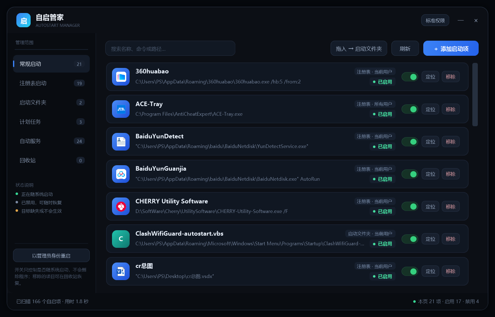

# 自启管家 · AutoStart Manager

Windows 启动项管理器。把散落在注册表 Run/RunOnce、启动文件夹、计划任务、系统服务里的开机自启项收进一个窗口，开关、移除、拖拽添加都在这里做。

单文件 PowerShell 5.1 + WPF，**零第三方依赖**：不装运行时、不编 exe、不写系统目录、不注册服务，双击即用。



## 功能

- **四类来源统一管理**
  - 注册表 Run / RunOnce（HKCU、HKLM、HKLM\WOW6432Node）
  - 启动文件夹（当前用户 + 公共）
  - 登录 / 开机触发的计划任务
  - 启动类型为「自动」的系统服务
- **开关**：注册表与启动文件夹走 Windows 自己的 `StartupApproved` 审批机制（与任务管理器同一套，不改动原值）；计划任务 `Enable/Disable-ScheduledTask`；服务在「自动 ↔ 手动」之间切换，关掉的会留在列表里标记「已停用」，可随时开回来
- **移除进回收站**：注册表值原样序列化备份、启动文件夹文件移入隔离目录、计划任务先导出 XML 再删除，回收站页可一键恢复或彻底删除
- **添加**：`＋ 添加启动项` 或直接把文件拖进窗口；落点可切换「启动文件夹 / 注册表 Run」；`.lnk` 直接复制，`.exe/.bat/.cmd/.vbs/.js/.wsf/.url/.com` 自动生成快捷方式，`.ps1` 包一层 `powershell.exe` 快捷方式
- **界面**：深色无边框圆角窗口、真实文件图标、状态圆点（绿=启用 / 灰蓝=已禁用 / 琥珀=目标缺失）、搜索、Toast 提示、拖拽浮层
- **单实例**：重复双击只把已有窗口激活到前台

## 快速开始

1. 下载整个目录（`AutoStartManager.ps1`、`启动自启管家.vbs`、`app.ico`、`自启管家.lnk` 放在一起）；
2. 双击 `自启管家.lnk` —— 通过 `wscript.exe` 静默启动，不会弹黑色命令行窗口；
3. 快捷方式失效时（例如把文件夹挪到别处），双击 `启动自启管家.vbs`，或右键 `AutoStartManager.ps1` → 使用 PowerShell 运行。

> 仓库里没有提交 `自启管家.lnk`（快捷方式内含绝对路径，换机器就失效）。第一次使用请运行一次下面的命令，或用 `.vbs` 启动：
>
> ```powershell
> $s = (New-Object -ComObject WScript.Shell).CreateShortcut((Join-Path $PWD '自启管家.lnk'))
> $s.TargetPath = "$env:SystemRoot\System32\wscript.exe"
> $s.Arguments = '"' + (Join-Path $PWD '启动自启管家.vbs') + '"'
> $s.WorkingDirectory = $PWD
> $s.IconLocation = (Join-Path $PWD 'app.ico')
> $s.Save()
> ```

## 各类项目的处理方式

| 分类 | 覆盖范围 | 开关 | 移除 |
| --- | --- | --- | --- |
| 注册表启动 | HKCU Run/RunOnce、HKLM Run/RunOnce、HKLM\WOW6432Node Run | 写 `Explorer\StartupApproved\Run`（HKLM 对应 `Run32`），偶数=启用、奇数=禁用 | 删值，原值（含二进制）备份进回收站 |
| 启动文件夹 | 当前用户 + 公共 `Startup` | 同上，`StartupApproved\StartupFolder` | 文件移入回收站 |
| 计划任务 | 含 LogonTrigger / BootTrigger 的任务 | `Enable/Disable-ScheduledTask` | 先 `Export-ScheduledTask` 存 XML 再 `Unregister` |
| 自动服务 | `StartMode=Auto` 的服务 | 自动 ↔ 手动（记录在 `services-changed.json`，关掉的仍可见） | 不提供，避免破坏系统 |

微软自家的任务与服务默认隐藏，勾选「含系统项」才会列出。

## 权限

- 默认以**标准权限**运行：当前用户的注册表项、用户启动文件夹都能管理，拖拽添加可用。
- 修改「所有用户」的注册表项、公共启动文件夹、计划任务、系统服务需要管理员权限；标准权限下这些操作会失败并给出提示，点左下角 **「以管理员身份重启」** 会弹 UAC 重新以管理员身份打开（单实例，不会开出两个窗口）。
- **提权后拖拽会失效**：从普通权限的资源管理器向管理员窗口拖文件，会被 Windows 的 UIPI（用户界面特权隔离）拦截，这是系统安全机制而非程序缺陷。此时改用 `＋ 添加启动项` 按钮选文件即可，效果相同。

## 数据与安全

- 禁用不改原值，只写审批字节，恢复时改回来即可；
- 移除一律进回收站，可恢复；彻底删除才会清理备份；
- 运行时数据都在用户目录，删掉这个目录不会影响系统自启项本身：

```
%LOCALAPPDATA%\AutoStartManager\
├─ quarantine.json          回收站索引（含注册表原值 / 任务 XML）
├─ services-changed.json      服务启用停用记录
├─ app.log                  异常日志
└─ Quarantine\              被移除的文件与任务 XML 备份
```

## 命令行参数

| 参数 | 说明 |
| --- | --- |
| `-SelfTest` | 仅校验 XAML 能否加载，输出 `SelfTest OK` 后退出 |
| `-DiagScan` | 扫描后打印各类计数并退出，用于排查扫描口径 |
| `-PreviewShot -PreviewPath <png>` | 离屏渲染界面截图（不弹窗、不占桌面） |
| `-AllowSecondInstance` | 跳过单实例互斥锁，供提权重启使用 |

## 已知限制

- 窗口固定尺寸（1180×756）无边框，不提供拉伸，高 DPI 下按系统缩放整体放大；
- 管理员模式下不支持拖拽（UIPI 限制，见上文「权限」）；
- 只处理常见的用户态启动入口，不涉及驱动、Active Setup、Winlogon Shell 等；
- 计划任务与服务的修改若被组策略锁定会失败并提示。

## 文件结构

```
AutoStartManager.ps1   主程序（XAML + 全部逻辑，单文件）
启动自启管家.vbs        静默启动器（wscript 隐藏控制台）
app.ico                应用图标（7 个尺寸：16~256）
使用说明.md             面向使用者的中文说明
docs/preview.png       界面截图
```

## License

MIT
